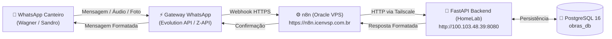

# 🏗️ Guia de Implementação: Workflows n8n para o Sistema de Obras

Este documento descreve a arquitetura, mapeamento de dados e templates JSON prontos para os workflows de automação no **n8n** hospedado na **Oracle VPS SGM**, integrando com o backend FastAPI no **HomeLab** e mensageria de WhatsApp.

---

## 🗺️ Topologia de Conexão



- **Host n8n:** `https://n8n.icenvsp.com.br` (Oracle Cloud SGM - `136.248.78.134`)
- **Backend HomeLab:** `http://100.103.48.39:8080` (Acesso direto via Tailscale VPN sem expor portas à internet)
- **Endpoint Principal:** `POST /api/v2/webhooks/n8n/requisicao`

---

## 📋 Catálogo de Workflows

### 1. `WF-01`: Inbound WhatsApp Requisição (Canteiro $\to$ Sistema)
- **Gatilho:** Webhook do Gateway WhatsApp.
- **Payload esperado pelo Backend:**
  ```json
  {
    "remetente": "Wagner (Mestre de Obras)",
    "texto": "preciso de 10 joelhos 25mm e 5 sacos de cimento",
    "audio_url": null
  }
  ```
- **Processamento:** O backend executa o parser de IA (`processar_requisicao_mensagem`), identifica insumos, unifica unidades e gera a requisição de compras pendente.
- **Resposta do Backend:**
  ```json
  {
    "status": "processado",
    "requisicao_id": 14,
    "total_itens": 2,
    "resposta_whatsapp": "✅ Requisição #14 registrada com sucesso!\n• 10x Joelho 25mm PVC Soldável Tigre\n• 5x Saco Cimento CP II 50kg Votoran\nAguardando liberação do Sandro para cotação no depósito JER.",
    "itens": [...]
  }
  ```

### 2. `WF-02`: Briefing Matinal Financeiro e Contas a Vencer
- **Gatilho:** Cron Schedule diário (às 08:00 de segunda a sexta).
- **Ação:** Consulta `GET http://100.103.48.39:8080/api/v2/financeiro/status`.
- **Destino:** WhatsApp pessoal do Gestor (Sandro).
- **Conteúdo:** Saldo em caixa da obra, parcelas de cartão a vencer nos próximos 3 dias e alerta de cotações pendentes de aprovação.

### 3. `WF-03`: Ingestão de Notas Fiscais e Cupons de Depósito
- **Gatilho:** Webhook de mensagem com anexo (imagem do cupom ou PDF de NF do depósito JER / Telhanorte).
- **Ação:** Envia multipart form para `POST http://100.103.48.39:8080/api/v2/documentos/fatura/upload`.
- **Retorno:** Confirmação de leitura do valor total, CNPJ do fornecedor e atualização automática da Curva S.

---

## 📦 Template JSON Pronto para Importação (`WF-01`)

Para importar:
1. No n8n, crie um novo workflow ou abra o editor.
2. Clique no menu superior direito `...` $\to$ **Import from JSON**.
3. Cole o conteúdo abaixo:

```json
{
  "name": "[Obras] Inbound WhatsApp Requisicao",
  "nodes": [
    {
      "parameters": {
        "httpMethod": "POST",
        "path": "whatsapp-obras-inbound",
        "options": {}
      },
      "type": "n8n-nodes-base.webhook",
      "typeVersion": 2,
      "position": [0, 0],
      "id": "node-webhook-inbound",
      "name": "Webhook WhatsApp"
    },
    {
      "parameters": {
        "method": "POST",
        "url": "http://100.103.48.39:8080/api/v2/webhooks/n8n/requisicao",
        "sendBody": true,
        "specifyBody": "json",
        "jsonBody": "={\n  \"remetente\": \"{{ $json.body.pushName || $json.body.sender || 'Wagner (Mestre de Obras)' }}\",\n  \"texto\": \"{{ $json.body.message || $json.body.conversation || $json.body.text || '' }}\",\n  \"audio_url\": \"{{ $json.body.mediaUrl || null }}\"\n}",
        "options": {
          "timeout": 15000
        }
      },
      "type": "n8n-nodes-base.httpRequest",
      "typeVersion": 4.2,
      "position": [260, 0],
      "id": "node-http-backend",
      "name": "FastAPI HomeLab (Tailscale)"
    },
    {
      "parameters": {
        "respondWith": "json",
        "responseBody": "={\n  \"success\": true,\n  \"requisicao_id\": {{ $json.requisicao_id }},\n  \"resposta_whatsapp\": {{ JSON.stringify($json.resposta_whatsapp) }}\n}",
        "options": {}
      },
      "type": "n8n-nodes-base.respondToWebhook",
      "typeVersion": 1.1,
      "position": [520, 0],
      "id": "node-respond-webhook",
      "name": "Resposta Webhook"
    }
  ],
  "connections": {
    "Webhook WhatsApp": {
      "main": [
        [
          {
            "node": "FastAPI HomeLab (Tailscale)",
            "type": "main",
            "index": 0
          }
        ]
      ]
    },
    "FastAPI HomeLab (Tailscale)": {
      "main": [
        [
          {
            "node": "Resposta Webhook",
            "type": "main",
            "index": 0
          }
        ]
      ]
    }
  },
  "settings": {
    "executionOrder": "v1"
  }
}
```

---

## 🔒 Boas Práticas, Privacidade e Segurança

1. **Privacidade Total das Mensagens Pessoais (Grupo Exclusivo):**
   - O n8n está configurado para escutar **exclusivamente o grupo oficial `"Obra ICENV"`**:
     - **ID do Grupo:** `120363411158164621@g.us`
     - **Instância Evolution:** `obras-canteiro`
   - **Regra de Filtro:** `{{ $json.body.data.key.remoteJid === "120363411158164621@g.us" && !$json.body.data.key.fromMe }}`
   - Qualquer mensagem recebida fora desse grupo (conversas privadas com família, amigos, clientes ou outros grupos) ou enviada pelo próprio bot é **descartada instantaneamente** no primeiro nó do n8n, garantindo 100% de sigilo pessoal.
2. **Isolamento de Rede:** O backend não deve ter a porta `8080` exposta na internet pública. Toda a comunicação deve fluir exclusivamente pelo IP da Tailscale (`100.103.48.39`).
3. **Tratamento de Áudios:** Para áudios do WhatsApp (`.ogg` codec Opus), se o gateway não transcrever nativamente, use o node **OpenAI (Whisper)** no n8n antes do nó HTTP, passando o binário recebido.
4. **Filtro de Remetentes no Grupo:** No n8n, processar apenas mensagens de membros autorizados do canteiro (Wagner e Sandro).
