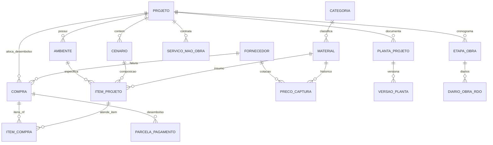

# 📐 Especificação Técnica de Engenharia (Tech Spec)
## Sistema de Gestão de Obras, Suprimentos e Canteiro — v2.2

---

### Controle do Documento
* **Projeto:** Sistema Integrado de Obras e Gestão de Suprimentos (ICENV 2026)
* **Versão:** 2.2 (Refaturamento Real, Migração PostgreSQL 16 & Design System Dark)
* **Data de Emissão:** 19 de Outubro de 2026
* **Classificação:** Documentação Técnica de Arquitetura e Engenharia de Software
* **Ambiente Operacional:** HomeLab Local (`192.168.15.176`) em Containers Docker + PWA Mobile + DBeaver Desktop

---

## 1. Visão Geral e Arquitetura do Sistema

O **Sistema de Obras** é uma plataforma distribuída offline-first e modular, desenvolvida para digitalizar a gestão física e financeira de reformas e construções civis. O ecossistema integra cotação em gôndola via OCR/IA multimodal, orçamento analítico com perda técnica paramétrica (+10%), rastreabilidade de compras reais com faturamento/parcelamento, controle de versionamento de pranchas arquitetônicas (R00, R01), acompanhamento de cronograma físico e relatórios para balcão de compras.

### 1.1 Topologia de Implantação

```
                                  [ Desktop Gestor / Engenharia ]
                                       |              |
                    DBeaver Desktop    |              | PWA Web Browser
                    (Porta 5435 SQL)   |              | (Porta 3080 HTTP)
                                       v              v
+-----------------------------------------------------------------------------------+
|  HomeLab Linux Host (192.168.15.176)                                              |
|                                                                                   |
|  +---------------------+      +---------------------+      +-------------------+  |
|  |  obras_frontend     |      |  obras_backend      |      |  obras_db         |  |
|  |  React 18 + Vite    | ---> |  FastAPI + Python   | ---> |  PostgreSQL 16    |  |
|  |  Porta 3080:5173    |      |  Porta 8080:8000    |      |  Porta 5435:5432  |  |
|  +---------------------+      +---------------------+      +-------------------+  |
|                                          |                                        |
|                                          v                                        |
|                             [ Storage /uploads & Plantas ]                        |
+-----------------------------------------------------------------------------------+
```

---

## 2. Modelo Relacional e Dicionário de Dados (PostgreSQL 16)

O banco relacional `obras_db` implementa 20 tabelas relacionais organizadas em módulos com integridade referencial forte (`FOREIGN KEY`), chaves primárias alfanuméricas/UUIDs e tipos monetários exatos `NUMERIC(14,2)` / `NUMERIC(12,2)`.



### 2.1 Especificação das Tabelas Principais

#### 2.1.1 `projeto`
Entidade raiz que agrupa frentes de obra e seus limites orçamentários.
* `id` VARCHAR(36) PRIMARY KEY (ex: `proj-icenv-pastoral`, `proj-icenv-masculino`, `proj-icenv-2024`).
* `nome` VARCHAR(150) NOT NULL: Título formal da obra.
* `status` VARCHAR(30): `Planejamento`, `Em Execução`, `Concluído`, `Suspenso`.
* `data_inicio` DATE, `data_previsao_fim` DATE.
* `orcamento_teto` NUMERIC(14,2): Valor total autorizado.
* `orcamento_mao_obra` NUMERIC(14,2): Previsão fechada de mão de obra.
* `orcamento_materiais` NUMERIC(14,2): Limite disponível para aquisição de insumos.
* `reserva_tecnica` NUMERIC(14,2): Contingência para imprevistos.

#### 2.1.2 `ambiente`
Frentes de serviço, cômodos ou setores com mensuração física de áreas.
* `id` VARCHAR(36) PRIMARY KEY (ex: `amb-pastoral`, `amb-masculino`, `amb-externa-pastoral`).
* `projeto_id` VARCHAR(36) NOT NULL (FK -> `projeto.id`).
* `nome` VARCHAR(100) NOT NULL.
* `area_piso` NUMERIC(10,2): Área de piso em m² (usado para dimensionar contrapiso e porcelanatos).
* `area_parede` NUMERIC(10,2): Área de paredes em m² (usado para azulejos e pintura).
* `perimetro` NUMERIC(10,2): Perímetro em metros lineares (usado para rodapés e peitoris).
* `planta_id` VARCHAR(36) (FK -> `planta_projeto.id`), `versao_planta_id` VARCHAR(36).
* `coordenadas_quadrante` VARCHAR(100): Eixo de localização (ex: `Eixo A-B / Parede Hidráulica`).

#### 2.1.3 `cenario` & `item_projeto` (WBS Orçamentário)
Estrutura de decomposição do trabalho (WBS) com precificação e perda técnica.
* `cenario.id` VARCHAR(36) PRIMARY KEY (ex: `cenario-pastoral-std`).
* `cenario.projeto_id` VARCHAR(36) NOT NULL (FK -> `projeto.id`).
* `cenario.nome` VARCHAR(150) NOT NULL, `cenario.ativo` BOOLEAN DEFAULT TRUE.
* `item_projeto.id` VARCHAR(36) PRIMARY KEY.
* `item_projeto.ambiente_id` VARCHAR(36) NOT NULL (FK -> `ambiente.id`).
* `item_projeto.material_id` VARCHAR(36) NOT NULL (FK -> `material.id`).
* `item_projeto.cenario_id` VARCHAR(36) NOT NULL (FK -> `cenario.id`).
* `item_projeto.qtd_necessaria_liquida` NUMERIC(10,2): Quantidade geométrica sem perdas.
* `item_projeto.margem_perda_pct` NUMERIC(5,2): Perda técnica paramétrica (10.00% padrão).
* `item_projeto.qtd_calculada_bruta` NUMERIC(10,2): Quantidade com perda aplicada.
* `item_projeto.qtd_embalagem_fechada` INTEGER: Embalagens inteiras a comprar (caixas/sacos).
* `item_projeto.preco_unitario_estimado` NUMERIC(12,2): Valor de referência unitário.

#### 2.1.4 `compra`, `parcela_pagamento` & `item_compra` (Módulo Financeiro)
Registro contábil e documental das notas fiscais e comprovantes de aquisição.
* `compra.id` VARCHAR(36) PRIMARY KEY (ex: `compra-telhanorte-005578`).
* `compra.projeto_id` VARCHAR(36) (FK -> `projeto.id`).
* `compra.fornecedor_id` INTEGER NOT NULL (FK -> `fornecedor.id`).
* `compra.numero_nf` VARCHAR(50): Número da NF-e, NFC-e ou Ordem de Venda.
* `compra.data_compra` DATE NOT NULL.
* `compra.valor_total` NUMERIC(12,2) NOT NULL.
* `compra.valor_frete` NUMERIC(12,2), `compra.valor_desconto_geral` NUMERIC(12,2).
* `compra.forma_pagamento` VARCHAR(30): `dinheiro`, `pix`, `cartao_credito`, `boleto`.
* `compra.quantidade_parcelas` INTEGER DEFAULT 1.
* `compra.foto_nf_url` TEXT: Caminho do PDF/imagem da nota fiscal.
* `parcela_pagamento.id` VARCHAR(36) PRIMARY KEY, `compra_id` (FK -> `compra.id`).
* `parcela_pagamento.numero_parcela` INTEGER, `data_vencimento` DATE, `valor_parcela` NUMERIC(12,2), `status` VARCHAR(20) (`Pago` ou `Pendente`).
* `item_compra.id` VARCHAR(36) PRIMARY KEY, `item_projeto_id` (FK -> `item_projeto.id`), `material_id` (FK -> `material.id`), `qtd_comprada` NUMERIC(10,2), `preco_unitario_real` NUMERIC(12,2).

#### 2.1.5 `planta_projeto` & `versao_planta` (Módulo de Pranchas)
Rastreabilidade de pranchas arquitetônicas e complementares.
* `planta_projeto.codigo_prancha` VARCHAR(50): Código mnemônico (ex: `ARQ-01`, `HID-01`).
* `planta_projeto.disciplina` VARCHAR(50): `Arquitetura`, `Hidráulica`, `Elétrica`, `Estrutural`.
* `versao_planta.revisao` VARCHAR(20): `R00`, `R01`, `R02`, `R_ASBUILT`.
* `versao_planta.status` VARCHAR(30): `Vigente`, `Superada`, `Em Revisão`.
* `versao_planta.metadados_extracao` JSON: Metadados extraídos das pranchas (áreas, pontos hidráulicos).

---

## 3. Reconciliação do Refaturamento Real (Obra ICENV 2026)

Na Reforma da Casa Pastoral, foram faturadas 8 compras reais consolidadas no banco de dados:

```
[ TOTAL FATURADO: R$ 19.932,96 ]
 ├── Quitado à Vista (Dinheiro): R$ 5.006,76 (25,12%)
 └── Parcelado em Aberto (Cartão): R$ 14.926,20 (74,88%)
      ├── Telhanorte (Venc. 17/11/2026): R$ 10.661,79 (3 faturas)
      └── Sodimac (6x Mensais até Abr/2027): R$ 4.264,41 (6 parcelas de R$ 710,73)
```

### 3.1 Tabela de Auditoria das Faturas Homologadas

| Chave de Registro (`id`) | NF / Pedido | Fornecedor | Data Emissão | Valor (R$) | Forma Pgto | Itens / Escopo Principal | Status Contábil |
| :--- | :---: | :--- | :---: | :---: | :---: | :--- | :---: |
| `compra-zumkeller-86007` | **86.007** | Depósito Zumkeller | 10/10/2026 | **R$ 4.196,59** | Dinheiro | 16 itens brutos: areia, cimento, pedra brita, blocos cerâmicos, vigas, laje H8, tinta emborrachada e frete | **Quitado** ✅ |
| `compra-zumkeller-86006` | **86.006** | Depósito Zumkeller | 10/10/2026 | **R$ 46,45** | Dinheiro | Plafon LED Sobrepor 24W Quadrado Ourolux | **Quitado** ✅ |
| `compra-longametragem-92041` | **92.041** | Longametragem Ferragens | 15/10/2026 | **R$ 52,80** | Dinheiro | 24 canaletas cerâmicas baianas para viga de respaldo | **Quitado** ✅ |
| `compra-zumkeller-86653` | **86.653** | Depósito Zumkeller | 16/10/2026 | **R$ 710,92** | Dinheiro | Tubulações soldáveis Krona 50/25, conexões esgoto 100/75, 20 sc brita e frete | **Quitado** ✅ |
| `compra-telhanorte-53813` | **53.813** | Telhanorte | 17/10/2026 | **R$ 3.261,79** | Cartão 1x | 37 itens: conexões Tigre, registros Deca, metais Docol Nova Logg, pintura Suvinil/Atlas | **Pendente** (17/11) ⏳ |
| `compra-telhanorte-005576` | **PED-005576** | Telhanorte | 17/10/2026 | **R$ 863,54** | Cartão 1x | 10,10 m² revestimento Fachada Mint 7,5x25cm e frete | **Pendente** (17/11) ⏳ |
| `compra-telhanorte-005578` | **PED-005578** | Telhanorte | 17/10/2026 | **R$ 6.536,46** | Cartão 1x | Porcelanato Eliane 90x90 (21,87m²), AC-III (13 sc), Bacia Smart Celite, Cuba Icasa, Vitrô Top Sul e frete | **Pendente** (17/11) ⏳ |
| `compra-sodimac-1918242567` | **OV-1918242567** | Sodimac | 18/10/2026 | **R$ 4.264,41** | Cartão 6x | 2 Janelas venezianas 6F 100x150cm CRV dormitórios e frete | **Pendente** (6 parcelas) ⏳ |

---

## 4. Especificação de Contratos da API REST (FastAPI v2)

Prefixos de rota atendidos: `/api/v2/*` (e retrocompatibilidade em `/api/*`).

### 4.1 Módulo de Projetos & WBS

#### `GET /api/v2/projetos`
Retorna a listagem agregada de todos os projetos cadastrados.
* **Response 200 OK:**
```json
[
  {
    "id": "proj-icenv-pastoral",
    "nome": "1ª Fase: Banheiro Casa Pastoral — Obra ICENV 2026",
    "status": "Em Execução",
    "data_inicio": "2026-10-13",
    "data_previsao_fim": "2026-11-02",
    "orcamento_teto": 39000.0,
    "orcamento_mao_obra": 17000.0,
    "orcamento_materiais": 22000.0,
    "reserva_tecnica": 3000.0,
    "total_ambientes": 3,
    "total_itens_wbs": 74,
    "total_compras_count": 8,
    "total_compras_valor": 19932.96,
    "percentual_concluido_medio": 28.0
  }
]
```

#### `GET /api/v2/projetos/{projeto_id}`
Retorna a árvore WBS hierárquica completa do projeto, incluindo ambientes, cenários, itens com perdas calculadas, etapas do cronograma, contratos de mão de obra e compras.

#### `GET /api/v2/projetos/{projeto_id}/itens`
Retorna os itens de orçamento em formato plano para alimentação de tabelas do frontend.
* **Query Params:** `cenario_id` (opcional), `ambiente_id` (opcional).
* **Campos Retornados:** `id`, `ambiente_nome`, `material_nome`, `fabricante`, `classe`, `tipo`, `unidade`, `quantidade_liquida`, `margem_perda_pct`, `quantidade_bruta`, `quantidade_embalagem`, `preco_unitario`, `preco_total`, `comprado`.

#### `POST /api/v2/projetos/{projeto_id}/itens`
Insere novo item no WBS.
* **Payload:**
```json
{
  "ambiente_id": "amb-pastoral",
  "material_id": "mat-br-cimento-cp2",
  "cenario_id": "cenario-pastoral-std",
  "qtd_necessaria_liquida": 15.0,
  "margem_perda_pct": 5.0,
  "qtd_embalagem_fechada": 15,
  "preco_unitario_estimado": 45.90
}
```
* **Cálculo Automático no Backend:**
  $$Q_{bruta} = \text{round}(Q_{liquida} \times (1 + \frac{\text{margem}}{100}), 2)$$

#### `PUT /api/v2/projetos/{projeto_id}/itens/{item_id}` & `DELETE /api/v2/projetos/{projeto_id}/itens/{item_id}`
Atualização e exclusão atômica de itens com recálculo automático de subtotais.

### 4.2 Módulo Financeiro & Suprimentos

* `GET /api/v2/financeiro/compras`: Suporta filtro `?projeto_id=proj-icenv-pastoral` e retorna fornecedores, parcelas e itens de cada nota fiscal.
* `POST /api/v2/financeiro/compras`: Registro de compra com emissão automática de parcelas de desembolso no calendário.
* `GET /api/v2/suprimentos/fornecedores`: Lista de parceiros e depósitos homologados com histórico.
* `GET /api/v2/suprimentos/materiais`: Catálogo mestre com último preço capturado e especificações de embalagem.

### 4.3 Módulo de Plantas e Pranchas

* `GET /api/v2/projetos/{projeto_id}/plantas`: Retorna pranchas cadastradas (`codigo_prancha`, `disciplina`) com todo o histórico de versões (`revisao: R00, R01`, `status: Vigente/Superada`, notas de revisão do arquiteto e metadados extraídos).

---

## 5. Arquitetura Frontend & Design System (v2.2)

### 5.1 Especificação de Tokens de Design
O frontend adota o tema **Dark Engineering Cockpit**, otimizado para alto contraste e legibilidade em dispositivos móveis no canteiro sob sol e em telas desktop de escritório:

* **Background Base:** `#0b0f19` (Slate 950 com tom de engenharia)
* **Superfícies de Cards e Containers:** `#0f172a` (Slate 900)
* **Bordas Estruturais:** `#1e293b` (Slate 800) e `#334155` (Slate 700)
* **Acentos e Ações:**
  * Primário: `#3b82f6` (Blue 500)
  * Sucesso / Executado / Concluído: `#10b981` (Emerald 500)
  * Alerta / Atenção: `#f59e0b` (Amber 500)
  * Perigo / Estouro: `#ef4444` (Red 500)
* **Tipografia Numérica:** `font-mono tabular-nums` obrigatório em todos os valores monetários, metragens quadradas e quantitativos, garantindo alinhamento perfeito de colunas.

### 5.2 Navegação e Componentização
A barra lateral de navegação (`Sidebar.tsx`) é organizada nas seguintes categorias de negócio:

1. **Visão Geral:** Cockpit Executivo (`ExecutiveDashboardScreen.tsx`).
2. **Planejamento & WBS:** Projetos & Orçamento WBS (`ProjectsScreen.tsx`) e Pranchas & Plantas (`BlueprintsScreen.tsx`).
3. **Operação de Campo:** Canteiro Mobile / Fotos / RDO (`MobileCanteiroScreen.tsx`).
4. **Inteligência & Automação:** Catálogo Mestre (`CatalogScreen.tsx`) e Fornecedores Homologados (`SuppliersScreen.tsx`).

### 5.3 Impressão Pautada de Balcão (A4 Print-Ready)
O componente `PrintBalcaoModal.tsx` gera ordens de compra limpas formatadas especificamente para impressão monocromática A4 (`@media print`), com linhas para anotação de preços reais e vistos de vendedores em depósitos locais.

---

## 6. Procedimentos de Operação e Auditoria SQL (DBeaver)

O gestor e a equipe técnica realizam inspeções e auditorias analíticas através do **DBeaver Desktop**:

### 6.1 Perfil de Conexão no DBeaver
* **Driver:** PostgreSQL
* **Host:** `192.168.15.176`
* **Port:** `5435`
* **Database:** `obras_db`
* **User:** `obras_user`
* **Password:** `obras_secure_pass_2026`

### 6.2 Queries Operacionais Homologadas

#### Auditoria Financeira Consolidada:
```sql
SELECT 
    p.id AS projeto_id,
    p.nome AS projeto,
    p.orcamento_teto,
    p.orcamento_materiais,
    COALESCE(SUM(c.valor_total), 0) AS total_compras_faturadas,
    (p.orcamento_materiais - COALESCE(SUM(c.valor_total), 0)) AS saldo_materiais
FROM projeto p
LEFT JOIN compra c ON c.projeto_id = p.id
GROUP BY p.id, p.nome, p.orcamento_teto, p.orcamento_materiais;
```

#### Fluxo de Desembolso Futuro por Vencimento:
```sql
SELECT 
    pp.data_vencimento,
    c.numero_nf,
    f.nome AS fornecedor,
    pp.numero_parcela,
    c.quantidade_parcelas,
    pp.valor_parcela,
    pp.status
FROM parcela_pagamento pp
JOIN compra c ON c.id = pp.compra_id
JOIN fornecedor f ON f.id = c.fornecedor_id
WHERE pp.status = 'Pendente'
ORDER BY pp.data_vencimento;
```

---

## 7. DevOps, Resiliência e Manutenção

### 7.1 Gestão de Containers Docker

```bash
# Reiniciar backend após atualizações
docker restart obras_backend

# Inspecionar logs em tempo real
docker logs -f obras_backend --tail 50

# Executar rotina de re-seed e migração
docker exec obras_backend python -m app.db.seed_projetos_completo
```

### 7.2 Rotina de Backup do Banco (`pg_dump`)

```bash
# Execução de snapshot atômico do banco
docker exec -t obras_db pg_dump -U obras_user -d obras_db -F c -b -v -f /var/lib/postgresql/data/backup_obras_$(date +%Y%m%d_%H%M%S).dump
```

---
*Documento homologado pela Engenharia de Sistemas e Diretoria de Obras ICENV.*
